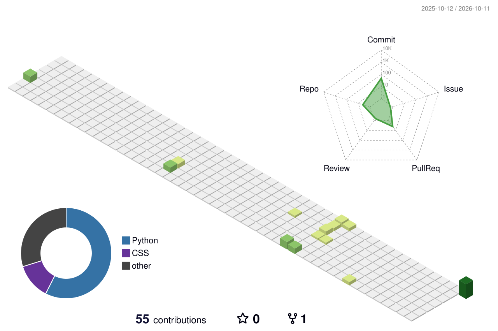

<h1 align="center">Hi, I'm Dhiraj P</h1>

  B.Tech CSE (AI &amp; ML) student at SRM Institute of Science and Technology, Chennai 
  I build AI-powered applications and web apps, with a focus on AI engineering and backend development.

  
  
  

---

## About

I'm a Computer Science (AI & ML) student at SRM Institute of Science and Technology, Chennai, drawn to the point where data turns into decisions. I'm most curious about how machines can learn from messy, real-world information, how language models can be grounded in facts instead of guesses, and how to build backends that make intelligent features dependable. I also care about technology that is accessible and useful to people who are often overlooked, and I like solving problems with clear logic and clean code. For me, good engineering means building things that are understandable, reliable, and honest about their limits.

## Projects

### [FinSight AI](https://github.com/dhiraj1308/finsight-ai)
An AI financial assistant that lets users upload bank or credit-card statements and explore their spending through a dashboard and a natural-language chat.

- Ingests CSV and PDF statements into a normalized transaction structure stored in SQLite
- Categorizes transactions, analyzes spending, detects anomalies and forecasts future spending
- Retrieval-augmented chat agent using embeddings and a vector store, with tools over the user's own transaction data
- FastAPI backend and an 8-page Streamlit frontend, with Pytest unit and frontend tests

         

### [visionaid](https://github.com/dhiraj1308/visionaid)
A web-based platform to learn Braille script, aimed at visually impaired learners through interactive, accessible education.

- Interactive web interface for learning the Braille script
- Designed around accessibility for visually impaired learners
- Browser-based, so it needs no installation

 

### [Margsetu-](https://github.com/dhiraj1308/Margsetu-)
A platform where young entrepreneurs pitch their ideas and connect with investors for funding opportunities.

- Lets young entrepreneurs present their ideas to potential investors
- Connects founders with investors looking for funding opportunities
- Web application built with JavaScript

  

### [weather-website](https://github.com/dhiraj1308/weather-website)
A website that shows live weather conditions such as temperature, wind speed and humidity for different locations.

- Shows live temperature, wind speed and humidity
- Lets users check weather conditions for different locations
- Browser-based site built with JavaScript

  

### [Daily-Life-Todo-list-](https://github.com/dhiraj1308/Daily-Life-Todo-list-)
A task app for adding and managing daily tasks, with add/delete animations and strikethrough completion tracking.

- Add and delete daily tasks quickly, with smooth animations
- Handles 100+ tasks
- Tracks daily productivity by striking through completed tasks

  

## Tech Stack

<b>Languages:</b>        
<b>Backend:</b>   
<b>Frontend:</b>   
<b>AI / ML:</b>         
<b>Databases & Tools:</b>       

## Contribution Graph

  

## Education

- **B.Tech, CSE (AI & ML)**, SRM Institute of Science and Technology, 2024 – 2028
- **Class XI & XII**, Narayana Jr. College, 2022 – 2024

## Achievements

- 3rd place, TechQuiz, IEI Student Chapter, SRMIST
- 2nd place, Espionage DSA Coding Contest, Dbug Labs, SRMIST
- Best Project Award, JAVA Project Expo 2025, SRMIST
- Top 10 Finalist, Day-Zero National-Level Hackathon
- Winter Research Intern, IIT Indore (Dec 2025)
